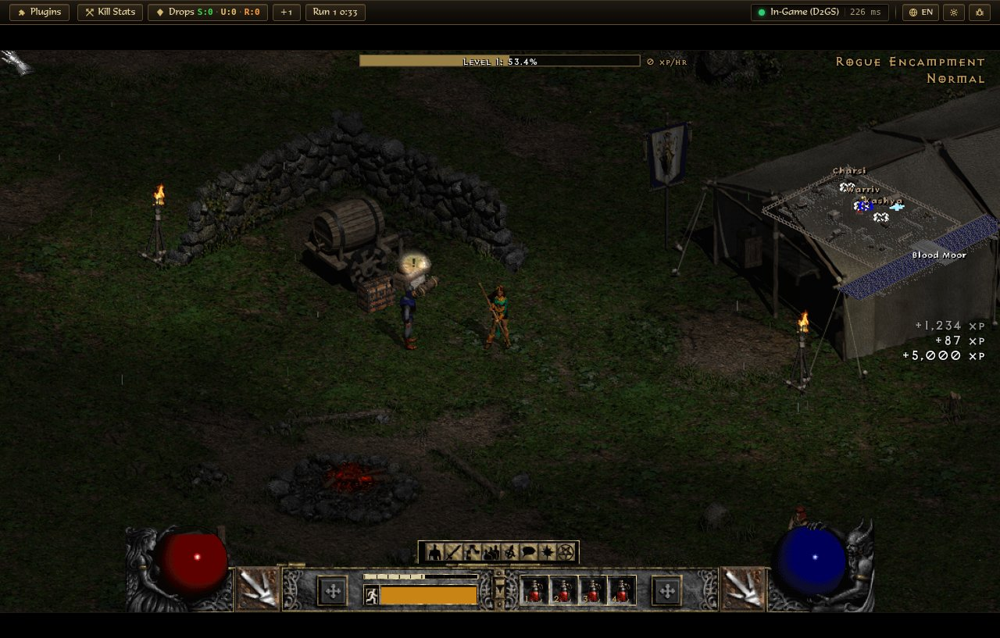

# diablo2-browser

[](https://github.com/David-Rodden/diablo2-browser/actions/workflows/ci.yml)

Diablo II: Lord of Destruction (1.13c) in your browser. It connects to real PvPGN + D2GS servers, so you play the actual game online, not a remake. On top of the base game it adds a set of optional quality-of-life mods.



## Getting started

You need Node 20+, ffmpeg 7+ with libopus, and the Diablo II 1.13c MPQ files from your own copy of the game. No game files are included here.

```bash
npm install
mkdir -p samples/d2 && cp /path/to/your/*.mpq samples/d2/
npm run bake -- all --ffmpeg /path/to/ffmpeg
npm run bake -- manifest
npm run dev
```

Open http://127.0.0.1:5173/play.html and log in.

The dev server connects to a public test server by default. To play on your own server, change the `/d2net` target in `vite.config.ts`.

## Updating

```bash
npm run sync
```

This pulls in the latest snapshot of the upstream engine and merges it. After a sync, re-run `npm run bake -- all` so the assets match the new code.

Files listed in `.upstream-filter` are left alone by the sync: `drop` keeps them out for good, and `keep` holds on to our version when upstream edits them.

## Mods

All mods can be switched off from the Plugins button in the toolbar. See [MODS.md](MODS.md) for the list.

## Credits

The engine builds on [diablo2-web](https://github.com/troytt/diablo2-web), [D2MOO](https://github.com/ThePhrozenKeep/D2MOO) and [StormLib](https://github.com/ladislav-zezula/StormLib).

MIT licensed (see [LICENSE](LICENSE)). Diablo II is a trademark of Blizzard Entertainment. This project is not affiliated with Blizzard.
